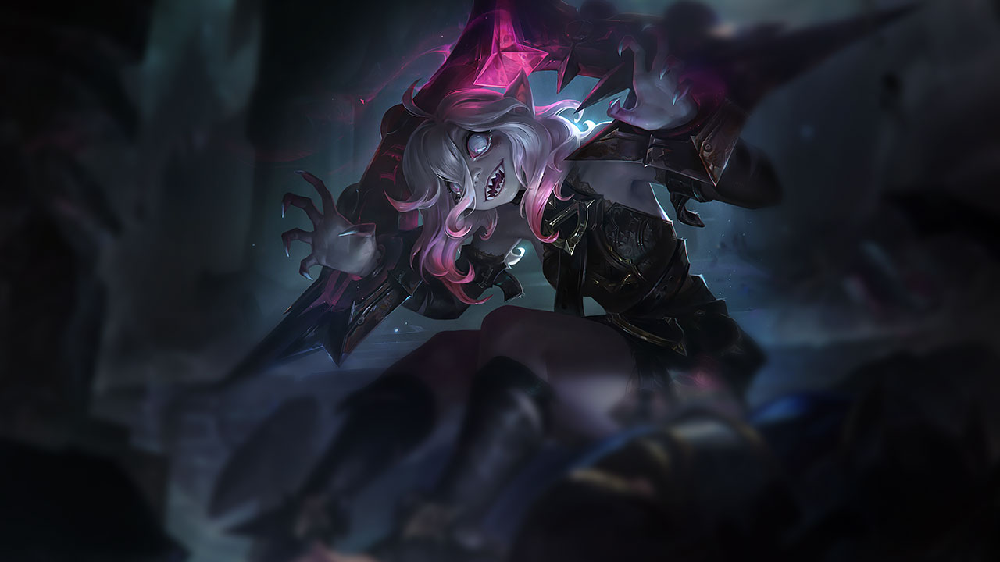

# Briar Bluesky Feed

A [Bluesky custom feed](https://bsky.app/profile/mb8055.com/feed/briar) for Briar from
League of Legends. It subscribes to the Bluesky firehose, keeps the posts that are Briar
fanart, and serves them back newest-first.

Feed URL: `at://did:plc:t6dzmaetp24txi5e2amguymz/app.bsky.feed.generator/briar`

## What it keeps

A post is kept when it carries any of `#briarlol`, `#briarleagueoflegends`, or
`#leagueoflegendsbriar` on its own, or when `#briar` is paired with a League context
tag — `#leagueoflegends`, `#lol`, `#leagueoflegendsfanart`, `#lolfanart`,
`#artoflegends`, `#league`, `#riotgames`. Posts whose text contains both "briar" and
"league" are kept as well, for clients that don't emit tag facets.

Posts tagged as AI art (`#aiart`, `#midjourney`, `#stablediffusion`, and the rest) are
dropped, no matter what else they match.
